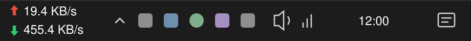

<p align="center">
  <picture>
    <source media="(prefers-color-scheme: dark)" srcset="docs/assets/logo-dark.svg">
    
  </picture>
</p>

<h3 align="center">Live NetLimiter upload and download speed on your Windows taskbar</h3>

<p align="center">
  A tiny, standalone taskbar speed meter for NetLimiter users on Windows 11 and 10.<br>
  Offline, no administrator rights, no hooks — and out of the way of your games.
</p>

<p align="center">
  <a href="https://github.com/yasirow/BandBar/releases"></a>
  <a href="https://github.com/yasirow/BandBar/releases"></a>
  <a href="https://github.com/yasirow/BandBar/actions/workflows/ci.yml"></a>
  
  
  
  <a href="LICENSE"></a>
  
</p>

<p align="center">
  <a href="https://github.com/yasirow/BandBar/releases/latest"></a>
</p>

<p align="center">
  <a href="#install">Install</a> ·
  <a href="#update">Update</a> ·
  <a href="CHANGELOG.md">Changelog</a> ·
  <a href="docs/DESIGN.md">How it works</a> ·
  <a href="docs/TESTING.md">Tests</a> ·
  <a href="SECURITY.md">Security</a>
</p>

<p align="center">
  
</p>

> [!NOTE]
> **Unofficial project.** BandBar is independent and open source. It is not affiliated with, endorsed by or
> supported by Locktime Software, the developer of NetLimiter. NetLimiter is their trademark. You need your own
> licensed copy of NetLimiter 5. When an official NetLimiter taskbar bar is available for your Windows version,
> prefer it.

## Why

NetLimiter's own taskbar bar is a taskbar toolbar (a "deskband"), and Windows 11 removed taskbar toolbars. BandBar
fills that gap: it shows the live upload and download speed using NetLimiter's official public API, as an ordinary,
separate window that never modifies the taskbar or any other program.

## Features

- **Compact two-line display** — red ⬆ upload above green ⬇ download, transparent background,
  B/s → KB/s → MB/s with one decimal. The text turns dark on a light taskbar and back when you switch themes.
- **Follows the taskbar** — sits just before the notification area on a top, bottom, left or right taskbar, and
  moves when the taskbar, the tray icons, the resolution or the scaling change, or when Explorer restarts.
- **Gets out of the way of games** — hides completely, and stops reading, while a full-screen or borderless
  windowed application is in front.
- **Light** — one ~100 KB executable, no runtime to install; about 0.02 % CPU while idle.
- **Safe by design** — no administrator rights, no network, no hooks or injection, no writes outside its own
  folder. NetLimiter's API is loaded from your own NetLimiter installation and its signature is verified first.
- **Resilient** — if the NetLimiter service stops, it shows `—` and reconnects by itself; it never shows an error
  dialog.

## Requirements

- Windows 11, or Windows 10 version 1903 or later — 64-bit (x64)
- A licensed installation of [NetLimiter 5](https://www.netlimiter.com/)

Nothing else: the .NET Framework 4.8 it uses is part of these Windows versions. (Windows 10 version 1809 works too
once .NET Framework 4.8 is installed from Microsoft; the setup checks for it and tells you if it is missing.)

## Install

1. Download the newest **`BandBar-Setup-x.y.z.exe`** from [Releases](https://github.com/yasirow/BandBar/releases/latest).
2. Run it. It installs for your user only and does **not** ask for administrator rights. Tick
   *Start BandBar when I sign in to Windows* if you want it to start automatically.
3. The bar appears on your taskbar, just before the clock and tray icons.

| Download | Use it when |
|---|---|
| `BandBar-Setup-x.y.z.exe` | Recommended. Start menu entry, optional autostart, clean uninstall. |
| `BandBar-x.y.z-portable.zip` | You prefer no installation: unzip anywhere and run `BandBar.exe`. |
| `SHA256SUMS.txt` | To verify your download. |

> [!TIP]
> Releases are not code-signed yet, so Windows SmartScreen may warn on first run — choose **More info → Run
> anyway**. To check that a file is exactly what the build produced, run
> `Get-FileHash .\BandBar-Setup-x.y.z.exe -Algorithm SHA256` in PowerShell and compare the hash with
> `SHA256SUMS.txt`. Every release is built by [GitHub Actions](https://github.com/yasirow/BandBar/actions) from
> the tagged source code.

## Update

BandBar never checks for updates by itself, because it never connects to the internet.

- **Get notified:** on this page, click **Watch → Custom → Releases**.
- **Update:** download the newer setup and run it. It closes the running bar, upgrades it in place and keeps your
  settings. With the portable ZIP, replace `BandBar.exe`.
- **What changed:** each release lists its changes, and they are all collected in [CHANGELOG.md](CHANGELOG.md).
- **Which version do I have?** Hover the bar; the first line of the tooltip shows it.
- **Updating NetLimiter itself?** Exit BandBar first (right-click → Exit). While it runs it keeps NetLimiter's API
  files open, and the NetLimiter installer would find them in use.

> [!IMPORTANT]
> Version 0.1.3 was published under the project's earlier name. If you installed it, exit it and uninstall it from
> **Windows Settings → Apps** (it is listed under that earlier name) before installing BandBar 0.1.4 or later.

## Uninstall

Open **Windows Settings → Apps → Installed apps → BandBar → Uninstall**. This removes the program, its shortcuts,
its uninstall entry and its own settings and log files — and nothing else. NetLimiter is not touched.
For the portable version, exit the bar and delete its folder.

## Using it

- **Hover** the bar for details: version, zone, connection status and NetLimiter version.
- **Right-click** the bar for the menu (currently: Exit).
- The bar shows NetLimiter's **Internet** zone by default.

| The bar shows | Meaning |
|---|---|
| Speeds with coloured arrows | Connected and up to date |
| `…` | Connecting to NetLimiter |
| `—` | The NetLimiter service is not running; BandBar reconnects automatically |
| `denied` | NetLimiter refused access (the Windows user needs NetLimiter's *Monitor* right) |
| `API?` | NetLimiter's files failed the signature check, or this NetLimiter version is not compatible |
| `NL?` | NetLimiter is not installed |

### Settings

Optional: create `settings.json` next to `BandBar.exe` and restart the bar. For example, to show two decimals,
use units of 1000 and a different green:

```json
{ "decimals": 2, "unitBase": 1000, "colors": { "download": "#00C853" } }
```

The text colour follows your Windows taskbar (light or dark). If a taskbar tool paints its own colours and the text
is hard to read, set `"theme": "dark"` (white text) or `"theme": "light"` (dark text).

All keys are listed in [docs/DESIGN.md](docs/DESIGN.md#81-settingsjson).

## Games, anti-cheat and privacy

BandBar is built to be invisible to games and anti-cheat systems:

- It installs no hooks, injects nothing, opens no handles to games and draws no overlay.
- It learns about full-screen applications from the same Windows notification the taskbar uses, then hides
  completely so it cannot interfere with full-screen optimisations.
- It runs as your normal user and never asks for administrator rights.
- It opens no network connections and collects no data. Its log stays on your PC and masks your user name, paths
  and computer name.

The full list of rules, and every Windows function the app is allowed to call, is in
[docs/DESIGN.md](docs/DESIGN.md#7-security-model).

## Build from source

```powershell
git clone https://github.com/yasirow/BandBar.git
cd BandBar
powershell -ExecutionPolicy Bypass -File .\build.ps1
```

You need the .NET SDK 10; NetLimiter is only needed to run the app. [CONTRIBUTING.md](CONTRIBUTING.md) shows how to
install the SDK inside the repository folder, how to create the release packages, and the rules every change follows.

## Roadmap

| Version | Planned |
|---|---|
| 0.2.0 | Drag the bar to any place on the taskbar and remember it; support auto-hiding taskbars |
| 0.3.0 | Multi-monitor full-screen detection; detect a game that is already full screen at start-up; optional game list and show/hide hotkey |
| 0.4.0 | Menu: choose the zone, open NetLimiter, switch Limiter / Blocker / Priorities (within NetLimiter's own permissions), Blocker request alerts, open the Releases page |
| 0.5.0 | Automatic light/dark text, taskbars on secondary monitors, code signing |
| 1.0.0 | Stable release |

## Contributing

Bug reports, ideas and pull requests are welcome — please read [CONTRIBUTING.md](CONTRIBUTING.md) first. Security
issues go through [private reporting](SECURITY.md), not public issues.

## License

[MIT](LICENSE) © BandBar contributors. See [THIRD-PARTY-NOTICES.md](THIRD-PARTY-NOTICES.md) for NetLimiter and the
build tools.
